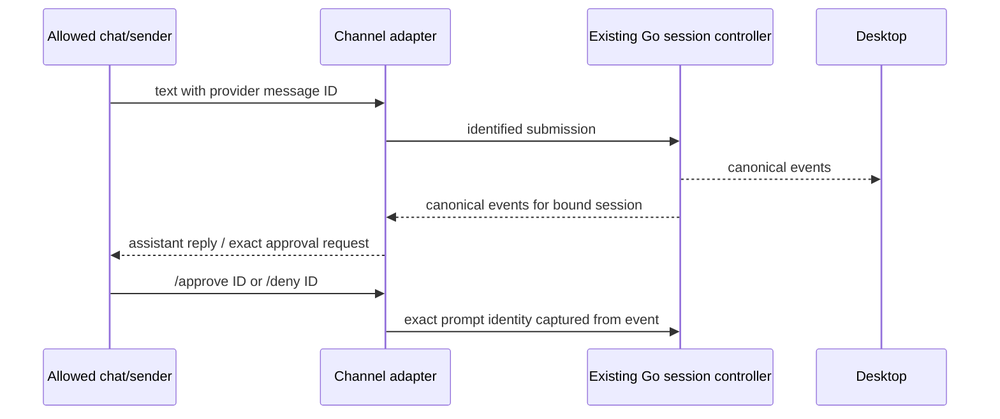

# Bot channels and Team members

## Current member binding

Channels now belong to a fixed Team member. In Settings → Team, edit a saved
member and open Messaging channels to configure Weixin/Feishu/Lark/Telegram.
The global Bot Channels page is the connection dashboard and can add a channel
to an existing member. A saved channel cannot be reassigned to another member.
Member model/session selection, preset, workspace, private/shared memory, tool
limits and permissions use the main branch's Team host and ordinary admission.
No second member identity or model credential store is created. The member's
initial model seeds new sessions; existing sessions keep their current model,
as in ordinary Team chats.

Before restoring old connections, migration creates a deterministic member for
each legacy bot, preserves credentials, allowlists and enabled state, and saves a
a private `connections.pre-members.json` backup. Credential files and migration
backups use mode 0600 on Unix and a protected, current-user-only DACL on Windows,
applied before writing secrets. Original sessions are never changed
or deleted. Verified completed history is forked into a canonical Team session;
the original remains linked through Open original conversation. Missing/empty
sessions start a new member chat. Unverifiable history blocks migration with a
visible error instead of silently losing context. Retrying between roster and
channel commits reuses the same member and fork. Existing Team data is retained.

Replies are correlated by canonical submission and turn identities registered
before admission. Only the requesting channel receives that task's replies and
approvals. Desktop tasks, team exchanges, schedules and unrelated channels are
not broadcast. `/stop` can cancel only a task owned by that channel; approval
answers retain their exact controller/turn/epoch identity. Local member chats
and channels share the member's conversation, so concurrent tasks use normal
busy/admission behavior. A busy request gets an explicit retry message.

Member runtime creation/recovery uses Team's background Ensure path without
changing Desktop focus. Idle eviction and model/preset rebuilds do not sever the
channel: each incoming message resolves its current member seat. Archived or
deleted members stop delivery; they are never silently recreated. Bot workers
stop before Team releases its runtime/lease during shutdown. Restart does not
replay old channel messages or automatically resend previously completed output.

The sections below retain the earlier local preview behavior and acceptance
history. Follow/dedicated configuration fields are retained for migration and
older configurations; new UI configuration selects Team members.

### Member integration verification (2026-11-04)

Integrated main `c8c50cc1b1e940a0d7a36c9735a02c8965f0160b`. Focused Desktop,
channel, team-host and root Team/control tests passed under the race detector.
Tests exercised real member controllers, two channels sharing a member without
cross-channel/Desktop output, exact approval ownership, migration retry,
completed-history preservation and restart restoration. Settings component and
TypeScript tests, Team/Bot browser flows, 252 settings-page and 180 layout cases
passed. Production frontend/shell builds and ad-hoc signature checks passed.

Native preview `v0.0.1-bot-team.20261104.7` migrated the existing Weixin and Feishu
connections to two fixed members, preserving their models, permissions, secrets,
access restrictions and enabled intent. Each original one-turn conversation
remained accessible; each new member conversation inherited that completed turn.
Both channels connected successfully and reconnected after a real quit/relaunch
without duplicate members. Native member → Messaging channels navigation showed
only the selected member's channel. No external chat message was sent by the
verification tools; live end-to-end replies remain the user's acceptance step.

Desktop provides a mobile-access entry and a Bot Channels settings manager for
Weixin, Feishu, Lark and Telegram. Public mobile Web access and QR remote control
are deferred. The UI must not manufacture a working remote-control QR code.

## Ownership and access

Each connection grants one configured chat and one configured sender access to
one local session. Empty access identifiers never mean public access.
The default `follow` mode shares an existing open conversation and uses its
current model. Legacy entries without `mode` retain this behavior.
The `dedicated` mode selects a workspace and an exact provider/model reference.
It creates its own conversation on first Connect through the existing durable
manual-creation manager, with no message submitted at creation. It never changes
the active Desktop conversation, its model, or the global default.
Assistant replies in that shared session are forwarded while connected, including
turns started on Desktop. The selected session ID is durable; tab selection cannot
retarget the connection. Enabled bots retain their runtime when its visible tab
is closed or navigated away. Genuine session/model/controller replacement still
invalidates the binding instead of silently retargeting it.
Both modes use ordinary Desktop controllers, canonical transcripts and the
existing execution queue.

Dedicated session identity is derived on the backend from bot ID, workspace ID
and model reference. A submitted session ID cannot hijack another conversation.
Reconnect and tab reopening reuse the same history; changing model/workspace uses
the conversation for that combination, retaining earlier conversations. Deleting
a bot does not delete its history. Dedicated sessions appear as `Bot · <name>` in
the sidebar and are excluded from the shared-session picker. Archiving/removing
one blocks reconnection instead of silently restoring it.
Creation uses the selected model with no fallback. A later model change in Desktop
invalidates the bot binding; reconnect cannot silently use the wrong model.
Model API keys stay in Model Services and never enter the bot configuration.
The editor offers an explicit, bounded, tool-free model test that neither saves
configuration nor connects the messaging provider. Missing credentials and known
authentication rejection block Connect. An untested configured key is not claimed
to be valid. Cards display the configured and currently running model separately;
model authentication failure is reported distinctly from channel connectivity.

Weixin, Feishu and Lark cards offer QR setup directly. Feishu/Lark QR registration
uses the official PersonalAgent device flow: begin at accounts.feishu.cn, switch
only to accounts.larksuite.com when tenant_brand requires it, respect polling
interval/slow_down and expiry/denial. Creating/authorizing the app requires the
user's phone action. App secrets and device codes stay in Go; the editor receives
only an opaque login handle, QR image, app ID and scanner open ID.
For this private-chat setup, `chatId=openid:<open_id>` routes replies using
`receive_id_type=open_id`. Inbound events must be p2p AND match that same sender;
a group message by that sender cannot pass the private-chat binding. Existing
manual chat_id configurations retain their ordinary chat routing.

Configuration is saved manually. New/stopped entries offer Save only and Save and
connect. Saving an enabled entry reconnects it with the saved configuration.
The persisted `enabled` flag records user intent: Connect enables it, Disconnect
disables it, and shutdown stops workers without changing it. Startup restores
enabled entries after Desktop tab restoration; shared sessions still loading are
waited for, and unavailable sessions/credentials show a connection error.
Legacy configurations without the flag remain stopped until explicitly enabled.
Navigation's Save and continue only saves new entries; it does not enable them.
Secrets are write-only in UI
and stored in a user-only local file, never in returned DTOs, logs or browser storage.
The entire Bot credential directory is private to the host's file readers,
including migration backups and temporary files. Existing credential snapshots
are loaded into exact-value masking before sessions start; edits remember both
old and replacement values before writing so in-flight replies remain masked
after rotation or deletion. An unreadable committed credential snapshot blocks
new outbound model requests until storage is repaired. Supported POSIX sandbox
assembly also includes existing host-private credential namespaces.
Saving/deleting a connected entry stops its worker first. A process lock prevents
multiple desktop instances consuming the same bot. Shutdown cancels and joins workers.
Save success and connect success are distinct: connection errors stay on the saved
card with retry and disable actions, without discarding a saved editor draft.

Channel routing follows the same canonical session, controller and event sink
across visible/background tab handoffs. A tab ID or presentation generation change
alone cannot disconnect a bot. Input still enters the current owner's admission
gate; another session/controller/model cannot inherit its access or approvals.
Per-connection counters record admitted messages and successful provider Send
returns. A send acknowledgement means provider acceptance, not a phone read receipt;
no message bodies or credentials are stored in these counters.

First delivery handles text and /help, /stop, /approve ID, /deny ID. Structured
questions and unsupported media direct the user to Desktop; they are never silently
converted to executable instructions. Feishu/Lark use long connections; Telegram
and Weixin use long polling. No public inbound webhook listener is opened.
Provider failure/status is distinct from saved configuration. Network errors must
not expose credentials or raw provider responses. Message IDs become durable
submission IDs so retries cannot execute the same text twice.

Incoming messages also have an account-scoped receipt journal before dispatch.
This prevents an old command from running after reconnect or session rebinding.
A crash between that receipt and submission requires an explicit new user message;
the channel does not promise exactly-once delivery. The journal stops admission at
20,000 receipts rather than evicting identities and allowing old command replay.
Delivery failures stop the connection and remain visible; the canonical response
stays in the Desktop transcript. Transient polling failures retry with bounded
exponential delay. Connections use the configured network proxy at connect time.

Weixin supports QR login as well as manual token entry. QR login credentials stay
in the Go process until Save; its opaque login handle expires after ten minutes.
Successful QR login retains `ilink_user_id` and returns it as `userId`, with no
credential in the UI result. For private Weixin chats, it fills both allowed chat
and sender IDs. The bot account's `ilink_bot_id` is never used as the access peer.
Edits made to access fields during login take precedence over late auto-fill;
cancelled/replaced login results cannot update the draft. Save also fills empty
IDs from the same login attempt. If the provider omits the user ID, keep manual
entry and show a rescan hint; never infer access from an arbitrary incoming sender.
Workspace-access/plan decisions and structured questions require Desktop review.

## Entry and setup

Use the phone icon at the bottom of the workspace sidebar, or Settings → Bot
Channels. Choose a provider, bind an open local conversation, and enter the exact
allowed chat and sender IDs. Choose Follow or a dedicated workspace/model.
Save, then Connect. Keep Desktop and the selected
conversation open. The channel forwards assistant messages from that conversation,
including Desktop-originated tasks, to the configured chat.
Wait for Connected before sending a new message. A fresh connection discards the
provider's pre-connection backlog so changing the shared session cannot execute
unseen messages intended for its previous binding. Reconnects within the same
worker retain their polling cursor; Weixin and Feishu/Lark events are fenced by
send time. Weixin validates credentials with a bounded `getconfig` request before
reporting Connected. Its first poll accepts messages sent since connection start,
even when mixed with older backlog; it does not wait for an empty poll. Messages
without a valid `create_time_ms` are skipped before admission or reply-context
caching. The time boundary and last nonempty cursor survive transient retries.

- Telegram: BotFather token; numeric chat ID and user ID. Existing webhook or
  another polling application must be disconnected by its owner first.
- Feishu/Lark: internal app with bot capability, messaging permissions and
  `im.message.receive_v1` subscribed via a long connection; publish the app.
  Use `chat_id` and the sender's `open_id`. The Lark entry uses the global endpoint.
- Weixin: QR login automatically fills both access fields from the scanning user's
  iLink ID. It is not the visible Weixin username. Manual token entry still requires
  the private-chat peer ID in both access fields.
  Send the first message from Weixin to establish its required reply context.

Provider message bodies and API contract details were referenced from ZCode
revision `a60ba6a7e5a06742270ca605f5d2cc2766afa7e1`; the Go integration is new.
Copied provider icons retain their Apache-2.0 license and notices in
`desktop/frontend/public/bot-channel-icons/`.

## Acceptance

- CRUD persists across restart; reads omit secrets; blank secret edit preserves it.
- Invalid providers, missing binding or missing allowed sender/chat are refused.
- Unauthorized senders and groups cannot submit, stop, approve or receive output.
- Duplicate message delivery uses the same submission identity.
- Rebinding/closing a session cannot route old requests or output to another session.
- Stop/delete/shutdown cancel polling and queued sends; errors remain visible.
- Settings support English/Chinese, loading/error/empty states, draft navigation
  protection and narrow layouts. Public Web access is visibly unavailable.
- Controlled provider tests and actual account acceptance are reported separately.

## Local verification (2026-11-03)

- Desktop Go `go test ./...` passed (main package: 535.836 s). Subsequent
  shutdown-order, proxy and connection-backlog changes passed focused race tests
  covering Bot channels, providers, shutdown and host command contracts.
- Production frontend build passed, including hooks lint, layer/host boundaries,
  theme/CSS checks, TypeScript and bundle budgets. Electron type checks passed.
- Electron tests: 323 passed. Settings responsive tests: 7 commands passed.
  Settings pages: 234 viewport cases; settings layout: 180 cases passed.
- `pnpm test:bot-channels` passed for English/Chinese, dark/light, 1400/900/400 px,
  provider editors, sidebar entry, unsaved drafts, CRUD, credential omission,
  failed QR login and visible connection failure. Screenshots were inspected.
- A real local Go session with a controlled model endpoint verified input,
  assistant reply and duplicate suppression. Provider HTTP fixtures verified
  Telegram, Weixin, Feishu/Lark domains/token reuse and Weixin QR generation.
- No real messaging-account login or live bot conversation was performed. Native
  packaged acceptance and public mobile Web/Relay deployment remain outside this
  delivery; no release or pull request was published.

### QR configuration follow-up

The initial migration exposed Weixin QR login inside a manual form and omitted
Feishu/Lark's PersonalAgent registration flow. QR setup now appears on provider
cards and at the top of the editor. Go provider/registration and Desktop tests
pass under the race detector; React tests cover all three QR providers, scanner
identity filling, manual edits, stale results and server-only secrets.
The live Feishu `begin` endpoint returned a valid device code and a QR URL on
`open.feishu.cn`; user phone authorization and real chat delivery are still
separate acceptance steps. No application is created without phone approval.
Packaged preview `v0.0.1-bot-channels.20261103.3` passed ad-hoc signature validation
and native startup/contract checks. Its Feishu setup page fetched and rendered a
real registration QR code successfully; phone authorization is left to the user.

### Weixin first-message fix (2026-11-04)

The initial Weixin backlog drain waited for an empty long-poll response and
discarded new messages received while the UI still showed Connecting. It now
validates the connection separately and filters each message by its send time.
Focused Go race tests pass for first-poll admission, readiness before a long poll
completes, credential failure, old/missing timestamps, cancellation and cursor
retention across retries, together with existing Bot/session and shutdown tests.
The user's saved credentials passed a live read-only configuration request;
actual Weixin message-to-model-to-reply acceptance remains a separate user test.
Preview `v0.0.1-bot-channels.20261104.4` passed the production frontend build,
ad-hoc signature verification and native startup. The old preview was quit;
the existing saved Weixin connection reached Connected in 517 ms with its bound
session open and no provider error. No external test message was sent by automation.

### Dedicated models and conversations (2026-11-04)

- Focused Go race tests passed for Bot, Weixin, Feishu, manual creation and
  shutdown. Controlled provider execution verified the dedicated model, isolation
  from the active conversation, persistent history after cold reopen, stable
  reconnect identity, mode switching, model-change refusal and credential omission.
- Eight settings component test commands passed. Browser verification covered
  both modes, missing credentials, model tests, preserved drafts and saved model
  selection across languages and viewport widths. The 234-case settings page
  matrix and 180-case layout matrix passed; narrow editor screenshots were inspected.
- Preview `v0.0.1-bot-channels.20261104.5` passed production build and ad-hoc
  signature verification, replaced the previous running preview, and passed native
  startup/contract checks. The existing Weixin credential and legacy Follow mode
  remain saved. Native configuration listed both saved model services; the editor
  exposes the dedicated mode and model test. Live chat on a user-selected model
  remains for the user's acceptance test. No release or PR was published.

### Connection lifecycle and runtime handoff (2026-11-04)

- Save and connect, save-only, edit/reconnect, persistent enable/disable intent and
  restore-after-startup passed controlled Go race tests. Startup waits for the
  Desktop restoration gate and does not duplicate a worker already started by
  the user. Shutdown preserves enabled state; manual Disconnect clears it.
- Real canonical OpenSession navigation to and away from an idle Bot conversation
  retained the exact runtime; incoming text used its selected model and the reply
  reached the controlled channel adapter. Unrelated-session events were excluded,
  and a real identity replacement stopped forwarding. Failed sends never increment
  the successful-send counter. Related shutdown, tab-close and navigation race
  regressions passed.
- The eight settings component commands, test TypeScript check, Bot browser flow,
  234 settings-page cases and 180 layout cases passed. Draft navigation saves a
  new bot without connecting; editing an enabled bot offers Save and reconnect.
- Native preview `v0.0.1-bot-channels.20261104.6` passed production build and
  ad-hoc signature verification. Existing Weixin and Feishu entries were saved
  with Connect enabled and both reached Connected with their configured models.
  Native navigation Weixin → Feishu → Weixin kept both connections active.
  After a real graceful quit/relaunch, both reconnected automatically without
  another Connect call. Actual new chat delivery remains for user acceptance;
  no chat test messages were sent by automation.
