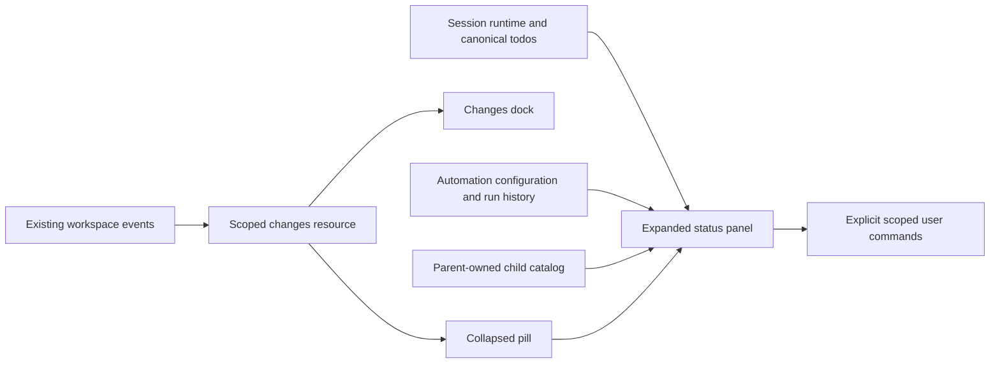

# Conversation status panel

The pill at the chat's upper right expands a session status panel. It contains
environment/Git, Goal, plan/todos, background shells, workflows and subagents.
Sections use authoritative data. Goal and plan sections appear when present;
supported task directories show their empty states when no runs exist.

- Git summary and the Changes dock share one scoped resource. Counts use the
  existing net diff against HEAD, plus bounded untracked-file statistics.
  Incomplete/failed refreshes retain an explicitly marked estimate. Branches
  and Git actions use the tab's expected workspace; actions offer staging,
  commit, fetch, fast-forward pull and ordinary push, with no force/reset.
  Commits consume staged content only. A workspace opened below the repository
  root rejects commits while any staged paths lie outside its visible subtree,
  including the outside half of a rename; rejection preserves HEAD and index.
- Goal uses its durable lifecycle and existing pause/resume commands. Progress
  shows recorded rounds and budgets, without guessing objective completion.
- Plan/todos use canonical todos and the pending plan approval text. Detail
  expansion never replays a historical tool call into the active todo list.
- Background output is a bounded, non-consuming read of the owning job. UI
  inspection must not advance job_output's cursor or collect its evidence.
  Completed jobs read the durable output tail after in-memory buffers are
  released. Both live and durable snapshots are bounded to 64 KiB and valid UTF-8.
- Workflows use Deepzora's existing automation tasks and run history, with links
  to their conversations. A recorded trigger is not proof of a successful run.
  Lifecycle events in other tabs refresh run details and history, coalesced
  while the panel is open and the page is visible.
- Subagents use the parent's host-owned child catalog. Their conversation is
  read-only and paged with history-window-v1. Cancellation targets the exact
  child runtime, without stopping the parent or a sibling.
  The backend rejects cancellation from read-only tabs. Cancelling a background
  child records its job as killed rather than failed.

Collapse state is presentation only. Session changes fence late results and
close the old panel. Hidden pages do not initiate summary scans. Refreshes
coalesce; opening the dock must not create another business-state owner.

Validation covers shared reads, session replacement, errors, watcher lifetime,
non-consuming job output, child ownership/cancellation, actual Git actions in
temporary repositories, and browser keyboard/layout/navigation paths.
