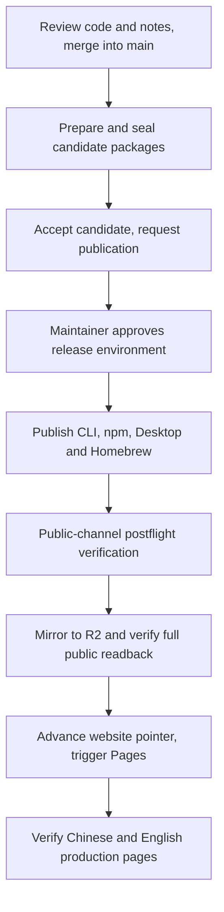

# Deepzora release handbook

[简体中文](RELEASE_HANDBOOK.zh-CN.md) | English

Repository: `SivanCola/deepzora`. Prepare and publish stable releases from protected
`main`. This handbook covers the CLI, npm, desktop app, Homebrew, R2 downloads,
and both website languages. Examples use `0.0.3`; replace it with the actual
version and retain the candidate ID, source SHA, and workflow run links.

For each release, maintainers review and merge code and bilingual release notes,
accept the candidate packages, and approve publication. Public-channel checks,
verified R2 mirroring, and website deployment then run automatically.



## 1. Pre-release checks

### 1. Account, tools, and source

- Use a GitHub account with repository access. Publication also requires permission
  to approve the `release` environment. Check the current reviewers under GitHub
  repository Settings → Environments → release.
- Install Git, GitHub CLI (`gh`), `jq`, Bash, and the Node.js version pinned in
  `.node-version`. Normal releases run in Actions; local R2 credentials and signing
  private keys are not required.
- Review the code and release notes through a PR, merge them into `main`, and
  require the corresponding CI to pass.
- Choose an unpublished stable version, such as `0.0.3`, without `v` in workflow
  inputs. Do not manually create `v0.0.3`, `npm-v0.0.3`, or `desktop-v0.0.3`;
  the publication workflow creates all three tags atomically.
- Confirm that no other publication for the same candidate is running or awaiting
  approval before dispatching another one.

Check identity and local state from the repository root:

```sh
git status --short --branch
git fetch origin main --tags
git log -1 --format='%H %s' origin/main
gh api user --jq .login
node --version
jq --version
```

Handle local changes before switching branches; do not overwrite them. Run local
release helpers from an up-to-date checkout of the official source. Remote
workflow commands always specify `--ref main`; being on a local feature branch
does not make those commands publish that branch.

### 2. Signing, publication credentials, and cloud settings

Use this table for initial setup, credential rotation, or failed preflight checks.
Check names and validity without putting values in documentation, logs,
screenshots, PRs, or ordinary repository files. Configure repository credentials
under GitHub Settings → Secrets and variables → Actions, and check the relevant
Environment for environment-scoped settings.

| Purpose | Actions Secrets | Actions Variables / external requirements |
| --- | --- | --- |
| macOS signing and notarization | `APPLE_CERT_P12`, `APPLE_CERT_PASSWORD`, `APPLE_API_KEY_P8`, `APPLE_API_KEY_ID`, `APPLE_API_ISSUER_ID` | Valid certificate and Apple credentials |
| Windows Authenticode | `CERTUM_USERNAME`, `CERTUM_OTP_URI`, `CERTUM_KEY_ID` | Valid signing service and certificate |
| Package integrity signatures | `MINISIGN_PRIVATE_KEY`, `MINISIGN_PASSWORD` | `MINISIGN_PUBLIC_KEY` |
| Official tags | `RELEASE_TAG_TOKEN` | Matching `RELEASE_TAG_ACTOR`, authorized by tag rules |
| npm / Homebrew | `NPM_TOKEN`, `HOMEBREW_TAP_TOKEN` | Publish access to the package and tap |
| R2 | `R2_ACCESS_KEY_ID`, `R2_SECRET_ACCESS_KEY`, `R2_ACCOUNT_ID`, `R2_BUCKET` | `ENABLE_R2_DOWNLOADS=true`; `R2_PUBLIC_BASE=https://downloads.deepzora.app` |
| Website | `CLOUDFLARE_PAGES_DEPLOY_HOOK` | Hook for `main` in Pages project `deepzora-website` |

Restrict R2 credentials to reading and writing `deepzora-releases`. The historical
`ENABLE_R2_MIRROR` variable does not replace the current package-mirror switch
`ENABLE_R2_DOWNLOADS`. Pages retains its native GitHub integration: production
branch `main`, root `website`, build command `npm run check`, output `dist`.
See [website configuration](../website/README.md) and [R2 configuration](R2_DOWNLOAD_MIRROR.md).

**Check Windows signing policy for the target version:** the current
[signing policy](../scripts/release-windows-policy.mjs) explicitly permits the
maintainer-approved unsigned exceptions for stable `0.0.1`, `0.0.2`, `0.0.3`, `0.0.4` and `0.0.5`.
Windows `0.0.5` does not require Certum configuration, but Minisign integrity
signatures, provenance verification and native acceptance of the final installers
remain mandatory. Keep the unknown-publisher and SmartScreen risks in the release
notes. This exception does not cover prereleases or unlisted versions such as `0.0.6`.

Before preparing each candidate, check the reviewed source policy and live
configuration. Run `node scripts/release-windows-policy.mjs 0.0.5 stable` to inspect
the target mode. A `certum` result requires all three `CERTUM_*` Secrets and a valid
signing service; otherwise the job fails with
`Certum signing configuration is incomplete for this Windows version`.
Missing credentials never select an unsigned fallback. Adding an exception or
changing the signing solution requires a separately reviewed policy change.

## 2. Prepare and review bilingual release notes

Add the target release at the top of
[release-notes/releases.json](../release-notes/releases.json). Follow the full
structure of an existing entry rather than changing only the version:

| Field | Example or requirement for `0.0.3` |
| --- | --- |
| `version`, `releaseId`, `baseVersion` | All `0.0.3` |
| `previousRelease` | Previous stable release, such as `0.0.2` |
| `date` | Actual planned release date, `YYYY-MM-DD` |
| `channel` / `status` | `stable` / `reviewed`; set `reviewed` only after review |
| `builds` | `cli: v0.0.3`, `desktop: v0.0.3`, `npm: 0.0.3` |
| Content | Chinese and English title, summary, changes, upgrade notes, known risks, product targets, and related PR/issue references |
| Links | Version-appropriate downloads, comparison, and documentation, following the existing structure |

`refs` supplies contributor credits. Signing status and privacy/code-signing
disclosures must match the actual packages. Validate the catalog and preview both
languages:

```sh
release_version=0.0.3
node scripts/release-notes.mjs validate
node scripts/release-notes.mjs render --version "$release_version" --lang zh --output /tmp/deepzora-release-notes.zh.md
node scripts/release-notes.mjs render --version "$release_version" --lang en --output /tmp/deepzora-release-notes.en.md
```

Review the generated files and merge the change into `main` through a PR.
Rendering uses `GH_TOKEN`, or attempts `gh auth token` when it is unset; the account
must be able to read the referenced issues and PRs. Resolve authentication,
rate-limit, or reference problems before proceeding instead of publishing
incomplete notes without credits.

Review the notes against every product change planned for the final release and
its known issues. A `status: reviewed` field or a passing schema check does not
prove coverage. Keep the date aligned with the actual release plan.

## 3. Prepare candidate packages

A push to `main` that changes `release-notes/releases.json` automatically triggers
[Prepare release candidate](https://github.com/SivanCola/deepzora/actions/workflows/release-candidate.yml)
for the catalog's first version. Check for an existing run first:

```sh
gh run list --repo SivanCola/deepzora --workflow release-candidate.yml --branch main --limit 10
```

Dispatch manually only when there is no suitable run, or a problem has been fixed
and a fresh preparation is needed:

```sh
release_version=0.0.3
gh workflow run release-candidate.yml --repo SivanCola/deepzora --ref main \
  -f version="$release_version" -f rehearsal=false
```

A manual run uses `main` at dispatch time; an automatic run uses the triggering
push SHA. The workflow checks reviewed Stable notes, source CI, and signing
configuration, builds CLI/npm and desktop packages, runs native acceptance against
the final packages, creates attestations, and seals the files. A valid existing
candidate with the same identity can be reused. Nothing is published publicly yet.

Wait for all candidate builds and sealing to succeed in Actions. Copy the complete
candidate ID from **Summary → Candidate ready**. To follow a run from the CLI,
replace `RUN_ID` with the actual numeric ID selected from the list:

```sh
gh run view RUN_ID --repo SivanCola/deepzora
gh run watch RUN_ID --repo SivanCola/deepzora --exit-status
```

The ID format is `v0.0.3-<12-character source identity>-<12-character catalog digest>`.
Copy it exactly; do not guess it from the version or use a rehearsal candidate for
publication. Record the Product / Control SHAs from Candidate input and confirm
the source includes the intended changes.

If `main` gains code or notes intended for this release after candidate preparation,
the existing candidate does not update automatically. Verify CI for the final
source and prepare a new candidate from it; do not approve an older candidate that
omits those changes. Later pushes changing only other files do not automatically
prepare a candidate, so use the manual command above when needed. Record the final
candidate source SHA and compare it with the intended release scope before publishing.

Download the sealed installers from that run's Artifacts. Check installation,
startup, version, main features, and upgrade paths for the intended release scope.
If manual acceptance finds a problem, stop publication, merge a fix into `main`,
and prepare a new candidate. Editing code or notes after sealing does not change
the files in an existing candidate.

Candidate payloads last **30 days**; records and evidence last **90 days**.
A retained record does not mean its packages are still available. If an unpublished
payload expires, prepare and accept a new candidate.

## 4. Request and approve publication

After accepting the candidate, set the actual ID from the Summary and request
publication from the repository root:

```sh
# Replace the placeholder with the complete candidate ID copied from Summary.
candidate_id='paste-complete-candidate-id'
./scripts/release-stable.sh "$candidate_id" publish
```

The helper dispatches a workflow; it does not mean publication has completed.
Open [Publish release candidate](https://github.com/SivanCola/deepzora/actions/workflows/release-promote.yml)
and confirm the candidate ID and `publish` operation in the run title. Preflight
verifies sealed files, provenance, notes, and tag permissions before requesting
approval for the `release` environment.

An authorized maintainer can approve through GitHub **Review deployments → release
→ Approve and deploy**, or run the following in an interactive terminal and type
the same complete candidate ID when prompted:

```sh
./scripts/release-approve.sh "$candidate_id"
```

Use either approval method once. The helper waits for preflight; if its waiting
window expires, inspect the workflow and rerun the approval helper rather than
dispatching another publication. If no active publication is found, check whether
the previous run failed or completed. Approval starts public publication. Do not
delete tags or rebuild packages under the same version to repair an interruption.

## 5. Wait for publication, R2, and website verification

| Stage | What success means |
| --- | --- |
| `activate` | The three official tags for one source commit were atomically created or verified |
| `cli`, `npm`, `desktop` | The products and Homebrew were published from sealed files |
| `postflight` | Public tags, GitHub Releases, npm, Stable manifests, and Homebrew passed verification |
| `Sync and read back every release object` inside `mirror` | Official source files and all R2 objects passed size and SHA-256 verification |
| `Save verified mirror inventory` | The verification report was saved |
| `Deploy and verify the official website` | Pages accepted a rebuild and fresh production metadata, both languages, and installer URLs passed checks |

The mirror is a reusable workflow and normally appears within the publication run.
An independent `Sync release downloads to R2` run is created when recovering the
mirror separately. Find the actual publication `RUN_ID` and follow it:

```sh
gh run list --repo SivanCola/deepzora --workflow release-promote.yml --branch main --limit 10
gh run watch RUN_ID --repo SivanCola/deepzora --exit-status
```

A visible GitHub Release or an accepted Pages hook is not proof that the whole
delivery completed. Require every stage above to succeed, then check:

- [Chinese downloads](https://deepzora.app/#download) and
  [English downloads](https://deepzora.app/en/#download): both show the target version.
- [Website release metadata](https://deepzora.app/release.json): the version,
  `sourceSHA`, `commitSHA`, `builtAt`, and inventory provide traceability.
- Download URLs use `https://downloads.deepzora.app/desktop/desktop-v0.0.3/…`.
  Select the correct operating system and architecture and check an actual download.

Inspect public metadata from the terminal if needed. `sourceSHA` identifies the
product release source; `commitSHA` identifies the `main` source used to build the
website. They have different purposes and need not be equal:

```sh
curl --fail --silent --show-error 'https://deepzora.app/release.json' \
  | jq '{version, sourceSHA, commitSHA, builtAt, files: (.files | length)}'
curl --fail --silent --show-error 'https://downloads.deepzora.app/website/latest.json' | jq .
```

Production builds read the verified R2 pointer, validate the immutable
`mirror.json` digest, size, source, and package matrix, then render both languages.
Do not manually update `website/src/release.json` for every release; it is the
offline development and PR-preview snapshot. Website deployment acceptance waits
up to 15 minutes; use the recovery procedure below if it times out.

## 6. Diagnose failures and recover

### 1. Identify the failed stage first

Keep the failed run URL and inspect the failed job/step in Actions. From the CLI:

```sh
gh run view RUN_ID --repo SivanCola/deepzora --log-failed
```

If a run is still active, wait for it to finish or cancel that run after confirming
it is no longer needed. Avoid multiple publications for the same candidate.
Fix credentials, permissions, or external services before retrying; retain branch,
tag, signing, and approval protections.

| Failure or symptom | Recovery |
| --- | --- |
| Release-note validation or credit resolution | Fix catalog structure, bilingual content, references, or GitHub access; review and merge before preparing a new candidate |
| Signing preflight, signing, or notarization | Check policy, credentials, and validity; prepare again after fixing the cause and do not approve a failed candidate |
| Build, source CI, installation, or native acceptance | Diagnose from logs; merge code fixes and prepare/accept a new candidate |
| Candidate preparation reports an existing official tag | Check whether that version is fully or partly public; recover the existing publication without moving or deleting tags |
| Unpublished payload expired or candidate revoked | Prepare again; recovery cannot bypass revocation |
| Tag identity/rules preflight before approval | Check `RELEASE_TAG_TOKEN`, `RELEASE_TAG_ACTOR`, and live tag rules; fix authorization before recovery or a fresh request for a publication not yet activated |
| Official tags, CLI, npm, Desktop, Homebrew, or public postflight interrupted | Use publication recovery with the same candidate |
| Product public checks passed; only R2 or website failed | Recover only the mirror/website without republishing npm or GitHub Releases |

### 2. Recover publication with the same candidate

Confirm that no run for this candidate is still active. Keep the original ID and
dispatch `recover`. Maintainer approval is still required; wait for product
verification and the R2/website stages afterward:

```sh
candidate_id='paste-original-complete-candidate-id'
./scripts/release-stable.sh "$candidate_id" recover
./scripts/release-approve.sh "$candidate_id"
```

Recovery reuses the sealed files and verifies existing tags and public channels.
It does not rebuild, sign again, or move tags to a newer `main`. If the product is
already partly public but the candidate files are unavailable, stop and reconcile
sealed evidence with the public bytes. Do not replace that version with a fresh
build; publish a new version after fixing the problem if necessary.

### 3. Recover only R2 mirroring or website deployment

Prerequisite: the target version passed product public-channel verification, and
its CLI and Desktop official tags identify one source commit. These commands
resync, verify, trigger the website, and check production:

```sh
release_version=0.0.3
gh workflow run release-mirror.yml --repo SivanCola/deepzora --ref main \
  -f version="$release_version"
gh run list --repo SivanCola/deepzora --workflow release-mirror.yml --branch main --limit 10
gh run watch RUN_ID --repo SivanCola/deepzora --exit-status
```

Alternatively, open
[Sync release downloads to R2](https://github.com/SivanCola/deepzora/actions/workflows/release-mirror.yml),
choose **Run workflow → main**, enter the target `version`, and verify success.

| Specific problem | Diagnosis and retry |
| --- | --- |
| R2 upload/download timeout or transient network failure | Restore connectivity and rerun the mirror; matching existing objects are reused and read back again |
| `will not overwrite`, digest mismatch, or size mismatch | Stop and compare the official Release, R2 objects, and report; do not force an overwrite to pass verification |
| Conditional pointer write conflict or `Website pointer changed after mirror` | Inspect concurrent/newer releases and rerun after confirming state; older backfills cannot downgrade the website |
| Missing hook or hook HTTP error | Check the main-branch Pages deploy hook and its encrypted GitHub Secret, then rerun the mirror |
| Pages build failure, website acceptance timeout, or stale pages | Inspect the corresponding main build in `deepzora-website`, remote metadata, and deployment; fix the cause and rerun the mirror |

Failures do not switch the website to partially verified packages. A failed build
retains the previous successful deployment. If Pages completes after acceptance
times out, inspect production metadata and rerun the mirror to obtain a complete
successful acceptance record. An older-version recovery preserves newer pointers
and may explicitly skip website deployment; it should not make the website show
the old version.

### 4. The published product itself has a defect

Fix the product and publish a new patch version. `recover` completes an interrupted
publication of the original candidate; it does not add fixes to that candidate.
Website code can be rolled back using the [Pages rollback instructions](../website/README.md),
but that does not downgrade the product, unpublish npm, or roll back download
pointers. The current mirror has no product-version downgrade command.

## 7. Optional rehearsal without publication

Use `rehearsal=true` to exercise signing and native acceptance, including for a
version with an existing reviewed catalog entry. Valid version-appropriate signing
configuration and source CI remain required; rehearsal does not bypass them:

```sh
gh workflow run release-candidate.yml --repo SivanCola/deepzora --ref main \
  -f version=0.0.2 -f rehearsal=true
```

After sealing succeeds, copy the rehearsal candidate ID and independently verify
provenance and file evidence across runs:

```sh
candidate_id='paste-complete-rehearsal-candidate-id'
gh workflow run release-candidate-verify.yml --repo SivanCola/deepzora --ref main \
  -f candidate_id="$candidate_id"
```

Rehearsal creates no official tags, public Releases, or npm packages, and updates
neither Homebrew, R2, nor the website. A rehearsal candidate cannot be promoted
into a publishable candidate.

## 8. Keep a release record

- [ ] Confirm the version, release-note PR, and intended product source SHA.
- [ ] Record successful candidate run, ID, Product / Control SHAs, and package acceptance.
- [ ] Record maintainer approval and the publication run URL.
- [ ] Require product public postflight, R2 verification, and website acceptance to succeed.
- [ ] Confirm both website languages, release metadata, and an actual download.
- [ ] Keep run/artifact links for the publication ledger, candidate evidence, and R2 report; related evidence generally lasts 90 days.

Completed baseline: the stable `0.0.2`
[mirror and website acceptance run](https://github.com/SivanCola/deepzora/actions/runs/41394695206)
succeeded on 2026-11-02, verified 33 versioned objects, and deployed both website
languages. This proves that delivery path; it does not replace signing setup or
candidate acceptance for future releases.

Related documentation: [candidate mechanisms](RELEASE_CANDIDATES.md),
[R2 operations](R2_DOWNLOAD_MIRROR.md), [website configuration](../website/README.md),
and [code signing policy](../CODE_SIGNING_POLICY.md).
