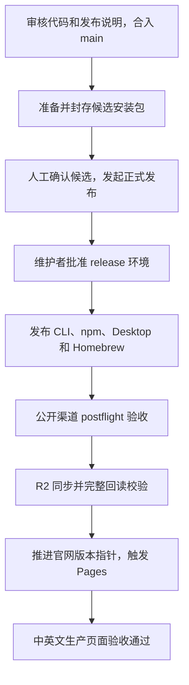

# Deepzora 中文发布手册

简体中文 | [English](RELEASE_HANDBOOK.md)

适用仓库：`SivanCola/deepzora`。正式版统一从受保护的 `main` 准备和发布。
本手册覆盖 CLI、npm、桌面端、Homebrew、R2 下载及中英文官网更新；以 `0.0.3`
为示例。每次操作请替换为真实版本，保留候选 ID、源码 SHA 和运行链接。

日常发版需要人工完成：审核并合并代码与中英发布说明、确认候选安装包、批准正式发布。
之后的公开渠道验收、R2 同步校验和官网部署自动执行。



## 一、发版前检查

### 1. 账号、工具和源码

- 使用具备仓库操作权限的 GitHub 账号；正式发布还需要 `release` 环境的审批权限。
  维护者名单以 GitHub 仓库 Settings → Environments → release 为准。
- 本机安装 Git、GitHub CLI (`gh`)、`jq`、Bash，以及仓库 `.node-version`
  指定的 Node.js。普通发版通过 Actions 执行，不需要在本机保存 R2 或签名私钥。
- 发布代码和发布说明已通过 PR 审核并合并至 `main`，相应 CI 通过。
- 版本使用尚未发布的稳定版本号，例如 `0.0.3`，输入工作流时不带 `v`。
  不手动创建 `v0.0.3`、`npm-v0.0.3`、`desktop-v0.0.3` 标签；由发布流程原子创建。
- 确认没有同一候选的另一个发布正在运行或等待审批，避免重复派发。

在仓库根目录检查身份和本地状态：

```sh
git status --short --branch
git fetch origin main --tags
git log -1 --format='%H %s' origin/main
gh api user --jq .login
node --version
jq --version
```

有本地修改时先处理好，不直接切分支覆盖它们。后续本地脚本应来自已同步的正式
源码检出；远端工作流始终指定 `--ref main`，不会因为本地位于功能分支而发布该分支。

### 2. 签名、发布凭据和云端设置

下表用于首次配置、凭据轮换或发版预检失败时核对。只检查名称和有效性，不把值写入
文档、日志、截图、PR 或普通仓库文件。配置入口为 GitHub Settings → Secrets and
variables → Actions；环境级配置同时核对相应 Environment。

| 用途 | Actions Secrets | Actions Variables / 外部要求 |
| --- | --- | --- |
| macOS 签名、公证 | `APPLE_CERT_P12`、`APPLE_CERT_PASSWORD`、`APPLE_API_KEY_P8`、`APPLE_API_KEY_ID`、`APPLE_API_ISSUER_ID` | 证书和 Apple 凭据有效 |
| Windows Authenticode | `CERTUM_USERNAME`、`CERTUM_OTP_URI`、`CERTUM_KEY_ID` | 签名服务和证书有效 |
| 安装包完整性签名 | `MINISIGN_PRIVATE_KEY`、`MINISIGN_PASSWORD` | `MINISIGN_PUBLIC_KEY` |
| 正式标签 | `RELEASE_TAG_TOKEN` | `RELEASE_TAG_ACTOR` 与凭据身份一致，且获标签规则授权 |
| npm / Homebrew | `NPM_TOKEN`、`HOMEBREW_TAP_TOKEN` | 对目标包、tap 有发布权限 |
| R2 | `R2_ACCESS_KEY_ID`、`R2_SECRET_ACCESS_KEY`、`R2_ACCOUNT_ID`、`R2_BUCKET` | `ENABLE_R2_DOWNLOADS=true`；`R2_PUBLIC_BASE=https://downloads.deepzora.app` |
| 官网 | `CLOUDFLARE_PAGES_DEPLOY_HOOK` | Pages 项目 `deepzora-website` 的钩子指向 `main` |

R2 凭据仅允许读写 `deepzora-releases`。不要用历史变量 `ENABLE_R2_MIRROR`
代替当前安装包镜像开关 `ENABLE_R2_DOWNLOADS`。Pages 保留原生 GitHub 连接，生产分支
为 `main`、根目录 `website`、命令 `npm run check`、输出目录 `dist`；详见
[官网配置](../website/README.md)和 [R2 配置](R2_DOWNLOAD_MIRROR.md)。

**Windows 按目标版本核对签名策略：**当前
[签名策略](../scripts/release-windows-policy.mjs)明确允许稳定版 `0.0.1`、`0.0.2`
和 `0.0.3` 使用维护者批准的未签名例外。Windows `0.0.3` 不以配置 Certum 为前提，
但仍必须通过 Minisign 完整性签名、来源验证和最终安装包的原生验收；发布说明须保留
未知发布者与 SmartScreen 风险。该例外不适用于预发布版或 `0.0.4` 等未列出的版本。

每次准备候选前，以已审核源码中的策略和实时配置为准，可运行
`node scripts/release-windows-policy.mjs 0.0.3 stable` 核对目标模式。返回 `certum`
时必须配置全部三个 `CERTUM_*` Secret 及有效签名服务，否则任务会报
`Certum signing configuration is incomplete for this Windows version`。
凭据缺失不会自动降级；新增例外或更换签名方案需要独立修改并审核发布策略。

## 二、准备并审核中英发布说明

在 [release-notes/releases.json](../release-notes/releases.json) 顶部新增目标版本记录。
参考已有记录填写完整结构，不只修改版本号：

| 字段 | `0.0.3` 示例或要求 |
| --- | --- |
| `version`、`releaseId`、`baseVersion` | 均为 `0.0.3` |
| `previousRelease` | 上一个正式版本，例如 `0.0.2` |
| `date` | 实际计划发布日期，`YYYY-MM-DD` |
| `channel` / `status` | `stable` / `reviewed`；审核完成后再设置 `reviewed` |
| `builds` | `cli: v0.0.3`、`desktop: v0.0.3`、`npm: 0.0.3` |
| 内容 | 中英标题、摘要、变更、升级提醒、已知风险、适用产品和关联 PR/issue |
| 链接 | 对应版本的下载、比较和文档链接，按已有结构填写 |

`refs` 会用于生成贡献者署名。签名状态、隐私和代码签名政策必须与真实安装包一致。
验证结构并预览两种语言：

```sh
release_version=0.0.3
node scripts/release-notes.mjs validate
node scripts/release-notes.mjs render --version "$release_version" --lang zh --output /tmp/deepzora-release-notes.zh.md
node scripts/release-notes.mjs render --version "$release_version" --lang en --output /tmp/deepzora-release-notes.en.md
```

打开生成文件人工审核后，经 PR 合并至 `main`。渲染时使用 `GH_TOKEN`，未设置时会
尝试 `gh auth token`；账号需能读取相关 issue/PR。失败时先修复鉴权、限流或关联编号，
不要发布缺少署名的半成品说明。

审核应覆盖最终计划发布的所有产品改动及已知问题，不能仅凭 `status: reviewed`
或结构校验通过判断说明已完整。发布日期应与本次发布计划一致。

## 三、准备候选安装包

`release-notes/releases.json` 的变更推送到 `main` 后会自动触发
[Prepare release candidate](https://github.com/SivanCola/deepzora/actions/workflows/release-candidate.yml)，
使用目录中第一个版本。先查看是否已有对应运行：

```sh
gh run list --repo SivanCola/deepzora --workflow release-candidate.yml --branch main --limit 10
```

只有没有合适运行，或修复问题后需要重新准备时，才手动触发：

```sh
release_version=0.0.3
gh workflow run release-candidate.yml --repo SivanCola/deepzora --ref main \
  -f version="$release_version" -f rehearsal=false
```

手动运行采用触发时的 `main` 源码；自动运行采用触发它的推送 SHA。任务会检查审核
完成的 Stable 说明、源码 CI、签名配置，构建 CLI/npm 与各平台桌面包，执行最终安装包
的原生验收、生成文件证明并封存。已有有效的相同候选可以复用；该阶段不公开发布。

在 Actions 页面等待候选构建和封存全部成功，查看 **Summary → Candidate ready**，
复制完整候选 ID。CLI 跟进方式如下；`RUN_ID` 必须替换为列表中选定的真实数字：

```sh
gh run view RUN_ID --repo SivanCola/deepzora
gh run watch RUN_ID --repo SivanCola/deepzora --exit-status
```

候选 ID 格式是 `v0.0.3-<12位源码标识>-<12位目录摘要>`。原样复制，不按版本号猜测，
也不要拿 rehearsal 候选发版。记录 Candidate input 中的 Product / Control SHA，
确认源码包含计划发布的修改。

若准备候选后 `main` 又合入计划随本版发布的代码或说明，旧候选不会自动更新。
重新核对最终源码的 CI，并从该源码准备新候选；不要批准缺少这些修改的旧候选。
仅修改其他文件的后续推送不会触发候选自动构建，必要时使用上面的手动触发命令。
发布前记录最终候选源码 SHA，与计划发布范围逐项核对。

从该运行的 Artifacts 获取封存安装包，按发布范围检查安装、启动、版本号、主要功能
和升级路径。人工发现问题时停止发布，修复后合入 `main` 并准备新候选。候选封存后
再修改代码或说明，不会改变这份候选的文件。

候选 payload 保留 **30 天**，record 与 evidence 保留 **90 天**。记录还在不代表
安装包仍可用；尚未发布而 payload 过期时，需要重新准备并验收。

## 四、发起正式发布并批准

确认候选通过后，在仓库根目录设置真实候选 ID，再发起发布：

```sh
# 将引号中的说明文字替换为 Summary 复制的完整候选 ID。
candidate_id='粘贴完整候选ID'
./scripts/release-stable.sh "$candidate_id" publish
```

脚本只派发，不代表发布完成。打开
[Publish release candidate](https://github.com/SivanCola/deepzora/actions/workflows/release-promote.yml)，
核对运行标题中的候选 ID 和操作是 `publish`。预检验证封存文件、来源、说明和标签
权限后，进入 `release` 环境审批。

由有权限的维护者在 GitHub **Review deployments → release → Approve and deploy**
批准；或在交互式终端执行以下命令，按提示输入同一完整候选 ID：

```sh
./scripts/release-approve.sh "$candidate_id"
```

两种审批方式任选一种。脚本会等待预检；超过等待窗口时先看工作流状态，再重跑
审批脚本，不重复派发发布。提示没有活动发布时，先检查上一次运行是否已失败或完成。
审批后 GitHub 开始公开发布；不要删除标签或重新构建同版本安装包来修复中断。

## 五、等待自动发布、R2 与官网验收

| 阶段 | 成功含义 |
| --- | --- |
| `activate` | 同一源码的三个正式标签已原子创建或验证 |
| `cli`、`npm`、`desktop` | 使用封存文件发布相应产品及 Homebrew |
| `postflight` | 标签、GitHub Releases、npm、Stable 清单和 Homebrew 的公开状态通过核验 |
| `mirror` 中的 `Sync and read back every release object` | 官方源文件及全部 R2 对象的大小与 SHA-256 校验通过 |
| `Save verified mirror inventory` | 保存本次校验报告 |
| `Deploy and verify the official website` | Pages 接受重建，且新的生产版本记录、中英文页面和安装包链接通过检查 |

发布任务内的镜像是可复用工作流，通常显示在同一次发布运行里；单独恢复镜像时才
有独立的 `Sync release downloads to R2` 运行。查看当前发布的真实 `RUN_ID`：

```sh
gh run list --repo SivanCola/deepzora --workflow release-promote.yml --branch main --limit 10
gh run watch RUN_ID --repo SivanCola/deepzora --exit-status
```

GitHub Release 出现或 Pages 钩子返回成功，都不能替代整条链路完成。确认上述阶段
全部成功，并查看以下公开页面：

- [中文官网下载区](https://deepzora.app/#download)与[英文官网下载区](https://deepzora.app/en/#download)：均显示目标版本。
- [官网版本记录](https://deepzora.app/release.json)：`version`、`sourceSHA`、`commitSHA`、`builtAt` 和文件清单可追溯。
- 下载链接指向 `https://downloads.deepzora.app/desktop/desktop-v0.0.3/…`；选择正确的系统和架构，抽查真实下载。

可在终端核对公开元数据。`sourceSHA` 是产品发行源码，`commitSHA` 是构建官网的
`main` 源码，两者职责不同，不要求相等：

```sh
curl --fail --silent --show-error 'https://deepzora.app/release.json' \
  | jq '{version, sourceSHA, commitSHA, builtAt, files: (.files | length)}'
curl --fail --silent --show-error 'https://downloads.deepzora.app/website/latest.json' | jq .
```

官网生产构建读取 R2 的已验证版本指针，再校验不可变 `mirror.json` 的摘要、大小、
源码和包矩阵，生成中英页面。无需每版手改 `website/src/release.json`，该文件用于
离线开发和 PR 预览。官网部署验收最多等待 15 分钟，超过时按下节恢复。

## 六、失败后的定位与恢复

### 1. 先确定失败阶段

保留失败运行链接，在 Actions 查看红色 job/step。CLI 可读取日志：

```sh
gh run view RUN_ID --repo SivanCola/deepzora --log-failed
```

若仍在执行，先等它完成或确认不再需要后取消对应运行，避免同一候选存在多个发布。
修复凭据、权限或外部服务问题后再重试；不放宽主分支、标签、签名或审批保护。

| 失败位置或症状 | 处理方式 |
| --- | --- |
| 发布说明验证、署名解析失败 | 修复目录结构、中英内容、编号或 GitHub 权限，审核并合并后重新准备候选 |
| 签名预检、签名、公证失败 | 核对签名策略、凭据与有效性；修复后重新准备候选，不能继续批准失败候选 |
| 构建、源码 CI、安装或原生验收失败 | 根据日志修复；代码变更合入后准备并验收新候选 |
| 准备候选时提示正式标签已存在 | 先检查同版本是否已公开或部分发布；已有发布进入恢复流程，不移动或删除标签 |
| 尚未发布的 payload 过期或候选被撤销 | 重新准备；被撤销候选不能通过恢复绕过限制 |
| 审批前的标签身份/规则预检失败 | 核对 `RELEASE_TAG_TOKEN`、`RELEASE_TAG_ACTOR` 与实时标签规则，修复授权后恢复或重新发起尚未激活的发布 |
| 正式标签、CLI、npm、Desktop、Homebrew、公开 postflight 中断 | 按“正式发布恢复”，复用同一候选 |
| 产品公开验收已通过，仅 R2 或官网失败 | 按“仅恢复 R2/官网”，无需重发 npm 和 GitHub Releases |

### 2. 正式发布恢复：使用同一候选

先确认没有同一候选仍在运行，保留原候选 ID。以下命令派发 `recover`，随后仍需
维护者审批，并等待产品验收与 R2/官网任务完成：

```sh
candidate_id='粘贴原来的完整候选ID'
./scripts/release-stable.sh "$candidate_id" recover
./scripts/release-approve.sh "$candidate_id"
```

恢复复用原封存文件，核对已存在的标签和发布渠道，不重新构建或签名，也不把标签
移到新的 `main`。如果产品已部分公开而原候选文件不可用，停止并核对封存证据和
已公开字节，不直接用新构建覆盖相同版本；必要时修复后发新的版本号。

### 3. 仅恢复 R2 同步或官网部署

前提：目标版本的产品公开渠道验收成功，CLI 与 Desktop 正式标签指向同一源码。
执行下面命令即可重新同步、校验、触发官网并验收：

```sh
release_version=0.0.3
gh workflow run release-mirror.yml --repo SivanCola/deepzora --ref main \
  -f version="$release_version"
gh run list --repo SivanCola/deepzora --workflow release-mirror.yml --branch main --limit 10
gh run watch RUN_ID --repo SivanCola/deepzora --exit-status
```

如果只需网页操作，在
[Sync release downloads to R2](https://github.com/SivanCola/deepzora/actions/workflows/release-mirror.yml)
选择 **Run workflow → main**，填目标 `version`，再确认运行成功。

| 具体问题 | 诊断与重试 |
| --- | --- |
| R2 上传/下载超时、临时网络故障 | 修复连接后重跑镜像；已存在且一致的对象会被复用并重新回读 |
| `will not overwrite`、摘要或大小不匹配 | 停止，核对官方 Release、R2 对象及报告；不能靠强制覆盖通过校验 |
| 指针条件写入冲突或 `Website pointer changed after mirror` | 检查并发/较新版本，确认状态后重跑；旧版回补不会降级新版 |
| 缺少钩子、钩子 HTTP 错误 | 核对 Pages 的 main 部署钩子和 GitHub 加密 Secret；修复后重跑镜像 |
| Pages 构建失败、官网验收超时或页面仍旧 | 到 `deepzora-website` 查看对应 main 构建日志，核对远端清单及部署；修复后重跑镜像 |

失败不会把部分包切入官网；构建失败保留上一次成功部署。若超时后 Pages 才成功，
先核对生产记录，再重跑镜像取得本次完整验收成功的记录。恢复旧版时，较新的版本
指针会保留，官网部署步骤可能明确跳过，不能据此要求官网显示旧版。

### 4. 已发布版本本身有缺陷

修复产品并发布新的补丁版本。`recover` 用于完成原候选的中断发布，不会把修复代码
装进旧候选。官网代码回退可按 [Pages 回滚说明](../website/README.md)操作，但
不等于降级产品、撤回 npm 包或回退下载指针；当前镜像不提供产品版本降级命令。

## 七、可选：只演练、不公开发布

在需要检验签名和原生验收链路时使用 `rehearsal=true`，可指定已有审核记录的版本。
这仍需要有效的对应签名配置和源码 CI，不能作为绕过正式校验的捷径：

```sh
gh workflow run release-candidate.yml --repo SivanCola/deepzora --ref main \
  -f version=0.0.2 -f rehearsal=true
```

成功封存后复制 rehearsal 候选 ID，独立复核跨运行复用的来源和文件证据：

```sh
candidate_id='粘贴演练候选的完整ID'
gh workflow run release-candidate-verify.yml --repo SivanCola/deepzora --ref main \
  -f candidate_id="$candidate_id"
```

演练不会创建正式标签、公开 Release、npm 包或更新 Homebrew、R2、官网；演练候选
也不能转成正式发布候选。

## 八、每次发版留档

- [ ] 版本号、发布说明 PR 和计划发布的源码 SHA 已确认。
- [ ] 候选运行成功，ID、Product / Control SHA、安装验收结果已记录。
- [ ] 正式发布经过维护者审批，运行链接已记录。
- [ ] 产品公开 postflight、R2 校验、官网部署验收全部成功。
- [ ] 中英文页面、版本记录和实际下载已确认。
- [ ] 保存发布 ledger、候选证据及 R2 校验报告的运行/artifact 链接；相关证据通常保留 90 天。

已完成的端到端基线：正式版 `0.0.2` 的
[镜像与官网验收运行](https://github.com/SivanCola/deepzora/actions/runs/41394695206)
于 2026-11-02 成功，校验 33 个版本化对象并部署中英文官网。
这是链路验收记录，不代替未来版本的签名配置与候选验收。

相关入口：[候选机制说明](RELEASE_CANDIDATES.zh-CN.md)、
[R2 维护说明](R2_DOWNLOAD_MIRROR.md)、[官网配置](../website/README.md)、
[代码签名政策](../CODE_SIGNING_POLICY.zh-CN.md)。
